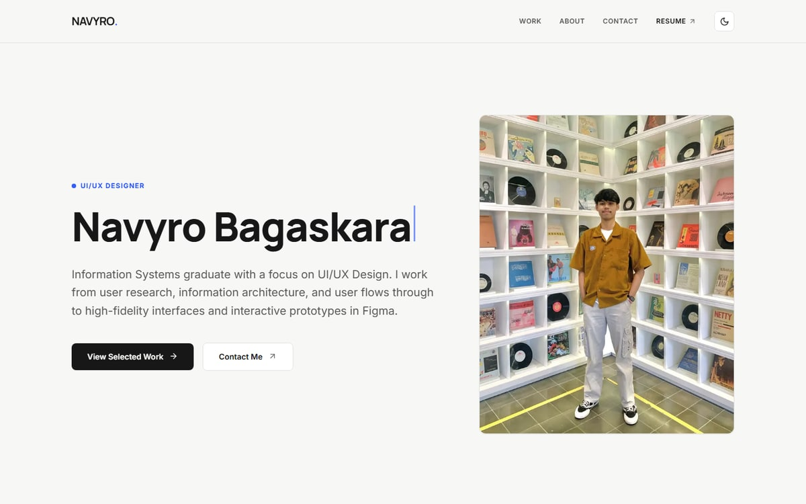
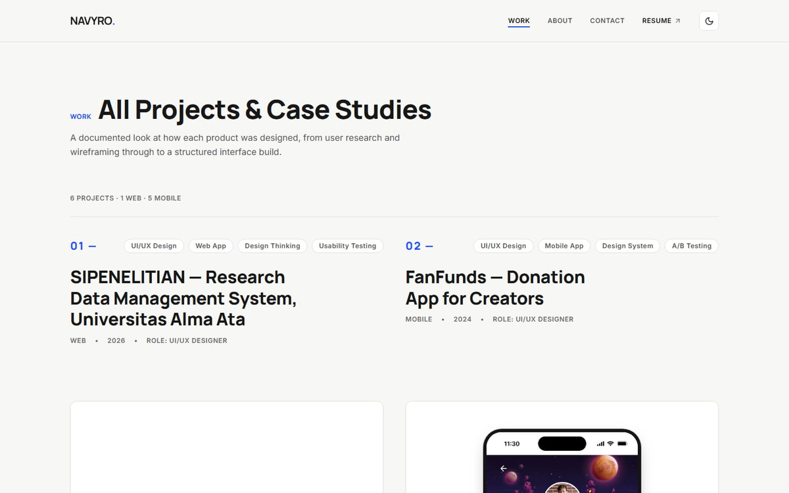

# Navyro Bagaskara — Portfolio

The personal portfolio site of **Navyro Bagaskara**, a UI/UX designer in Bekasi, Indonesia.
It holds six case studies of real work — from field research for a village waste-billing app to a
personal-finance concept — and the site itself is the second half of the argument: a designer who
can also read and adjust the code.

**Live:** https://navyro-bagaskara-portfolio.vercel.app

 

## What is in it

| Route | Content |
| --- | --- |
| `/` | Hero, selected work, about summary, contact call to action |
| `/work` | Six case studies, each with its own cover, slides and detail page |
| `/work/[slug]` | Full case study: problem, process, decisions and outcome |
| `/about` | Profile, experience, education, skills and tools |
| `/resume` | Experience, certifications with verification links, and the CV downloads |
| `/contact` | Contact details and a message form |
| `/resume` + `/about` | Downloadable CV in English and Indonesian, plus a PDF portfolio |

Every case study links to its Figma prototype, so the thinking can be checked against the artefact.

## Built with

- **Next.js 14** (App Router, static rendering where possible)
- **TypeScript**
- **Tailwind CSS** with a light/dark token system driven by CSS variables
- **next-themes** for the theme switch, `next/image` for optimised delivery
- **Framer Motion** for the reveal animations, **lucide-react** for icons

The shared JavaScript bundle is around 87 kB on first load, and every image is served through the
Next.js image optimiser rather than at its original size.

## Running it locally

```bash
npm install
npm run dev      # http://localhost:3000
```

Production build:

```bash
npm run build
npm start
```

## Checks

The repository ships with the checks that guard the things a portfolio cannot afford to get wrong —
dead links, broken social previews, and metadata:

```bash
npm run check      # links + Open Graph + SEO, 10 assertions
```

It also covers:

- keyboard reachability of every route, with a visible focus ring on each stop;
- a print stylesheet, so `/resume` prints as a document instead of a screenshot of a navbar;
- layouts that survive a 320 px screen and 200 % text zoom without horizontal scrolling;
- light and dark themes that both pass contrast, and motion that respects
  `prefers-reduced-motion`.

## Deploying

Production lives at <https://navyro-bagaskara-portfolio.vercel.app>. Every push to `main` deploys
through GitHub Actions (`.github/workflows/deploy.yml`), which runs the Vercel CLI with a token kept
in the repository's Actions secrets.

Vercel's own Git integration is not used: it links repositories through a GitHub App installed on the
account that owns them, and the Vercel account here is tied to a different GitHub identity. The
workflow is the substitute, and it builds the same way.

The same deploy can be run by hand:

```bash
npm run ship       # git push origin main, then vercel --prod
```

## How it was made

I designed it and built it myself, working with AI assistants as a pair-programmer. That means I can
read and adjust this codebase and judge what is realistic to ship — and that deep JavaScript is still
where I am learning, not where I claim mastery. The design decisions, the content and the case-study
writing are mine.

## Contact

- Email — [navbagaskara@gmail.com](mailto:navbagaskara@gmail.com)
- LinkedIn — [in/navyro-bagaskara](https://www.linkedin.com/in/navyro-bagaskara/)
- Instagram — [@navyroo](https://www.instagram.com/navyroo/)

---

© 2026 Navyro Bagaskara. Design and case-study content are mine; please ask before reusing them.
